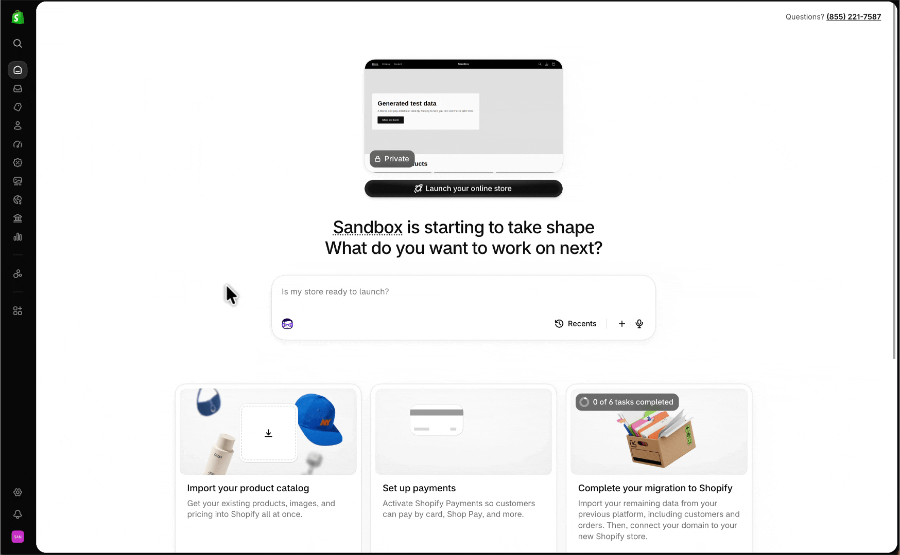

# Overview
A curated collection of useful skills to help you run your store on Shopify.

# Sidekick
## Skills
Each skill in the `skills` folder above has its own `SKILL.md` file. Shopify's Sidekick supports dragging and dropping a `SKILL.md` file directly into the chat.

**To download all skills:**
1. Click the "Code" button above.
2. Click "Download ZIP".

**To download individual skills:**
1. Click "skills" above.
2. Click the skill folder you want (e.g. aov).
3. Click "SKILL.md" to view the file's contents.
4. Click the Download icon on the right hand side ("Download raw file" will show).

**Once you have the skill(s) downloaded:**
1. Drag the `SKILL.md` file(s) into a new Sidekick chat.
2. Prompt Sidekick to "Add these skill(s) to your agent skills".
